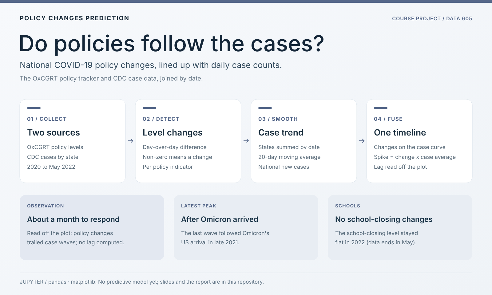
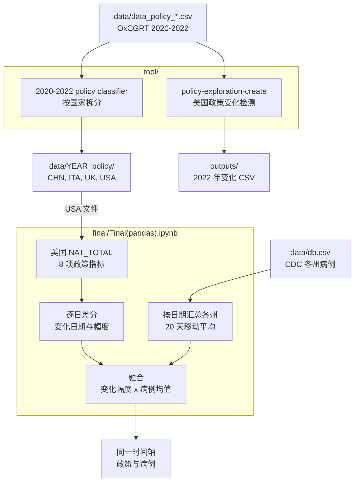

<div align="center">

# Policy Changes Prediction

[English](README.md) · **简体中文**

**国家层面的 COVID-19 政策何时发生变化？把政策等级与每日病例数放在同一条时间轴上。**


[](https://www.ccao2679.com/projects/#policy-changes-prediction)



</div>

<!-- problem-framing:start -->

## 问题与依据

> **当每个特征都只使用预测日当天已有的信息时，病例历史特征能否在持续性基线之外，进一步提升对未来政策变化记录的预测？**

**为什么值得解决：** 时间序列在图上对得上，并不代表具备预测能力。一个可复现的回顾性检验能说明数据中是否真的包含有用的提前信息。

**核心矛盾：** 平滑可以降低上报噪声，却可能泄漏未来的观测值，或模糊罕见政策变化的时间点。相关性也无法说明政府为何改变政策。

[完整问题与验证方案](PROBLEM.zh.md) · [English](PROBLEM.md)

<!-- problem-framing:end -->

## 亮点

- **数据来源：** [OxCGRT](https://github.com/OxCGRT/covid-policy-tracker) 的国家政策等级，以及 CDC 按州统计的每日病例数（汇总为全国总数），按日期拼接。
- **方法：** 政策指标的等级只要与前一天不同，就记为一次政策变化；病例数用 20 天移动平均平滑后，与政策画在同一条时间轴上。
- **观察：** 从合并后的图上看，政策变化比病例高峰滞后约一个月，最近一次高峰出现在 Omicron 传入美国之后；代码并未计算滞后。notebook 确认 2022 年学校关闭（school closing）等级没有变化。
- **预测：** 目前没有训练任何预测模型。`tool/policy_wise_exploration.ipynb` 搭了树回归模型的框架，但其输入路径（`../outputs/ .csv`）指向一个仓库中不存在的文件。

## 架构



箭头表示数据流向。`tool/` 中的 notebook 把 OxCGRT 文件按国家拆分，并列出美国 2022 年的政策变化；`Final(pandas).ipynb` 把每次国家级政策变化画成一个尖峰，高度为变化幅度乘以 20 天病例均值，让政策变化和病例波峰落在同一条时间轴上。

## 快速开始

在 Jupyter 中打开 `final/Final(pandas).ipynb`。`tool/<year> policy classifier.ipynb` 这几个 notebook 按国家（中国、意大利、英国、美国）筛选每年的 OxCGRT 文件，并不训练分类器。

## 目录结构

| 路径 | 用途 |
|---|---|
| `final/` | 最终分析 notebook 与各国政策 CSV（2020–2022） |
| `tool/` | 各年份按国家筛选的 notebook（`<year> policy classifier.ipynb`）、美国政策变化检测，以及一个未完成的建模 notebook |
| `data/` | 原始及清洗后的政策数据和病例数据 |
| `outputs/` | 检测出的 2022 年国家级与州级政策变化 |
| `docs/` | 报告、幻灯片和海报 |

<details>
<summary>原始报告（英文）</summary>

DATA605 big data system project

Predict National Policy Changes based on Case Data

<!--more-->

## Policy Data

Data Source:

[OxCGRT/covid-policy-tracker](https://github.com/OxCGRT/covid-policy-tracker)

> Beginning on October 20, 2022, the CDC retrieves aggregate case and death data from jurisdictional and state partners on a weekly basis rather than daily. This dataset contains archived aggregate daily counts of COVID-19 cases and death by state. Although these data will continue to be publicly available, as of 10/20/2022, this dataset will no longer be updated.
> A new dataset which aggregates weekly COVID-19 cases and deaths by State can be found at: Weekly United States COVID-19 Cases and Deaths by State | Data | Centers for Disease Control and Prevention (cdc.gov). This new dataset is compiled using different methodology; please see the corresponding description on the new dataset for additional details.

## Two policy


### **National Policy**
(We can focus on state policy as well, but we use national policy as an example. It is more clean and more complete)


After cleaning, we get a dataset about "Date", "Strictness Level" and "Policy".


The number reveals the levels of strictness
|Number|Meaning|
|---|---|
|1.0|Low|
|2.0|Medium|
|3.0|High|
|4.0|Vert strict|
|NaN|No data|


#### How can we know when the policy changed?


Because it is national policy data, it won't change frequently.


The number of rows means the days in 2022. (Each row represent one day)

All I need to do is calculate the difference between each two day and find the variances.

```python
dfNP.loc[:,'C1_School closing'].rolling(window=2).apply(lambda x: x.iloc[1] - x.iloc[0]).unique()
```
The output is ` array([nan,  0.]) `, which means it haven't changed from beginning to the present.

To compare the results, we list c4.
```python
dfNP.loc[:,'C4_Restrictions on gatherings'].rolling(window=2).apply(lambda x: x.iloc[1] - x.iloc[0]).unique()
```
The output is ` array([nan,  0.,-2.]) `, which means it changed and skipped 2 levels.

We mark the row where the differences are not 0, and we get the date when the policy changes.


#### Since the number of level is so small, how can we make it visualiable?
Use the  difference times total case.

Most differences are 1.0. 

We can do fusion and plot the policy and cases in one graph.


## COVID Case Data


### Main source

[United States COVID-19 Cases and Deaths by State over Time](https://data.cdc.gov/Case-Surveillance/United-States-COVID-19-Cases-and-Deaths-by-State-o/9mfq-cb36/data)

It provides csv file.


#### Backup datasets

-  [CSSEGISandData/COVID-19](https://github.com/CSSEGISandData/COVID-19)

      (Messy)

      Novel Coronavirus (COVID-19) Cases, provided by JHU CSSE

- [C~~OVID-19 Open Research Dataset Challenge (CORD-19)~~](https://www.kaggle.com/datasets/allen-institute-for-ai/CORD-19-research-challenge)

  CORD-19 is a resource of over 1,000,000 scholarly articles, including over 350,000 with full text, about COVID-19, SARS-CoV-2, and related coronaviruses. 

- [nytimes/covid-19-data](https://github.com/nytimes/covid-19-data)

  <u>Only foucs on USA</u>

  An ongoing repository of data on coronavirus cases and deaths in the U.S.

- [pcm-dpc/COVID-19](https://github.com/pcm-dpc/COVID-19)

  Only focus on **Italy**

  COVID-19 Italia - Monitoraggio situazione (not English?)

- [owid/covid-19-data](https://github.com/owid/covid-19-data)

  Looks good~ But not so reliable.


### Case Data


After sorted by submission date, We can draw a graph based on new cases data.


#### Why is it so rough? Can we make it more smoother?
Weekend (except some missing data)

Count the mean number of each 20 days.

It is really good.


## Fusion
```python
matplotlib.rcParams['figure.figsize'] = [15, 10]
dfC_proc.plot(x='submission_date',y=polColumns+['new_case_MA20'])
# <AxesSubplot:xlabel='submission_date'>
```


In this graph, we can clearly tell the trend of new cases and when the policies changed.

> First Omicron in US:November 2021 (11/22/2021)[First Confirmed Case of Omicron Variant Detected in the United States](https://www.cdc.gov/media/releases/2021/s1201-omicron-variant.html)


## Conclusion
1. Normally, it takes one month to respond.
2. Last peak was caused by Omeicron.
3. No policy changes made this year with regrad to School Closing.
4. We can speculate that new policy changes will happen in June.

----
## 4Vs
### Volume
Total datasets are up to 500 MB.

### Variety
Policy and Case.
But it includes so many different datasets.

### Velocity
Though it was reported that "Java heap space", it runs fast and is almost real-time.

### Veracity
Those two sources are reliable.
(CDC and [OxCGRT](https://www.bsg.ox.ac.uk/research/research-projects/covid-19-government-response-tracker))

</details>
